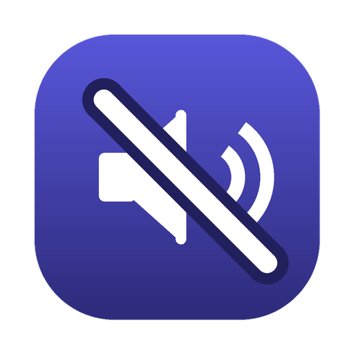

# Auto-mute

Petite app macOS qui **coupe le son quand le Mac est resté inactif** un certain temps
(10 minutes par défaut). Elle vit dans la barre de menus, n'a pas de fenêtre et ne
demande aucune autorisation particulière.



## Ce qu'elle fait

- surveille l'inactivité clavier / souris / trackpad (toutes les 15 secondes) ;
- au-delà du seuil, coupe la sortie audio, une seule fois, puis se réarme dès que
  l'ordinateur est retouché ;
- ne remet jamais le son toute seule.

Le menu affiche la durée d'inactivité en cours et permet de changer le seuil
(2 min à 1 h), de couper ou rétablir le son à la main, de mettre l'app en veille,
et de la lancer à l'ouverture de session.

## Installation

```bash
git clone https://github.com/jmsantolin/auto-mute.git
cd auto-mute
./build.sh --install
```

`build.sh` compile l'app avec le Swift fourni par les outils de ligne de commande
Xcode ; `--install` la copie dans `/Applications` et la lance. Sans l'option, l'app
est construite dans `build/`.

Pour la lancer à chaque démarrage : menu de l'app → **Lancer au login**, ou
Réglages Système → Général → Ouverture → Ouvrir au login.

## Sous le capot

- `Sources/main.swift` — toute l'app (AppKit, `NSStatusItem`) ;
  inactivité via `CGEventSource.secondsSinceLastEventType`, coupure du son via
  `set volume output muted true` ;
- `Resources/make-icon.py` — génère `AppIcon.icns` ;
- préférences dans `com.jmsantolin.auto-mute` (`enabled`, `thresholdSeconds`).

macOS 13 ou plus récent.

## Licence

MIT
